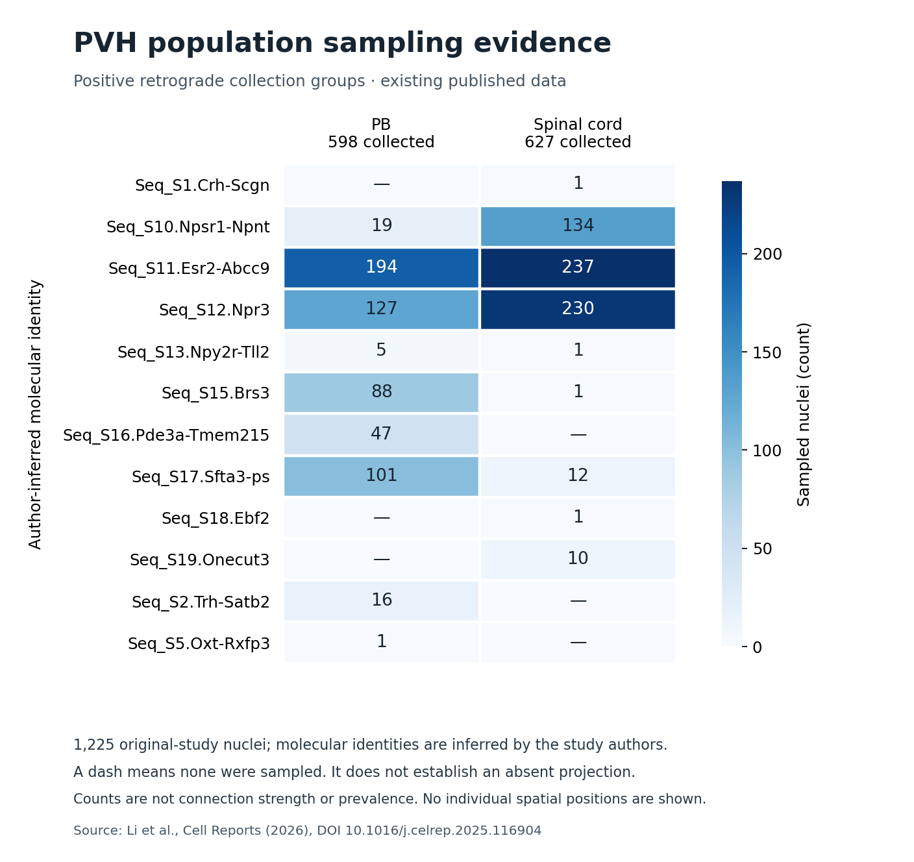

# PVH population pilot: evidence map and exploratory collection-label prediction

## Summary

This pilot uses only public, existing data from one study of the paraventricular hypothalamus (PVH). It has
two parts.

1. **Evidence map:** which author-inferred PVH cell types appear among nuclei collected after retrograde
   labelling from the parabrachial nucleus (PB) or from the spinal cord (SC).
2. **Exploratory prediction test:** whether raw nuclear gene counts can predict a nucleus's collection group
   (PB or SC) when the model is trained on one sex's pools and tested on the other sex's pools.

**Main result:** no method beats every control on both log loss and Brier. Nothing is promoted.

* **Lowest-log-loss methods:** two nearest-neighbour averaging models, with log loss 0.675721 and 0.675835,
  only slightly better than the training prior at 0.693147.
* **Technical control:** library size and detected-gene count alone reach 0.683889.
* **Gene logistic model:** it ranks nuclei better than chance, but its probabilities are lopsided across pools.
  Its log loss of 0.693571 is no better than the prior, although its Brier score is the lowest.

**What this is not:** it does not measure independent animals, absolute projection strength, projection to
any other target, positions, axon paths, synapses or unknown circuits. It is not a claim of novelty.

## Data and what the labels mean

* **Study:** Li, Resch and colleagues, *A spatial and projection-based transcriptomic atlas of
  paraventricular hypothalamic cell types*, Cell Reports 45:116904 (2026),
  [DOI 10.1016/j.celrep.2025.116904](https://doi.org/10.1016/j.celrep.2025.116904),
  [PMC13007250](https://pmc.ncbi.nlm.nih.gov/articles/PMC13007250/).
* **Data:** [GEO GSE303256](https://www.ncbi.nlm.nih.gov/geo/query/acc.cgi?acc=GSE303256) and the author
  objects on Zenodo, [DOI 10.5281/zenodo.15983704](https://doi.org/10.5281/zenodo.15983704). Both objects
  match their published MD5 checksums.
* **Units:** each record is one nucleus with measured nuclear RNA counts.
* **Labels:** "PB" and "SC" mean the nucleus was in the author's PB-projecting or SC-projecting retrograde
  collection group.
  * A PB nucleus is not a verified non-projector to SC, and the reverse.
  * Other targets and dual projection are unknown.
* **Pools:** each encoded pool combines 4 to 10 mice, and there is only one pool for each sex and target.
  Pools are not animals.
* **Positions:** none were measured in these RNA data, so no location comparator exists. The study's spatial
  (MERFISH) data come from a separate cohort and were not paired with these nuclei.
* **Cell types:** the author's `predicted.celltype` label is an inferred identity. It is used only to group
  the evidence-map counts. It was never a model feature or a gold label.

## Part 1: evidence map (run pvh_population_atlas_v1)

* **Scope:** the 1225 original-study nuclei (PB 598, SC 627). The 2498 SC nuclei reused from other studies
  are excluded.
* **Unknowns stay unknown:** 960 nuclei have no known pool. Animal, position and other-target fields are null
  for every nucleus, and no coordinates were invented.

*Figure: counts of collected nuclei by author-inferred identity and collection group. Identities are
author-inferred. Counts are sampling evidence within the collected nuclei; they are not connectivity
strength, prevalence or evidence of absence.*

**What the counts show:**
* Esr2-Abcc9 and Npr3 types are common in both collection groups.
* Npsr1-Npnt types are mostly in the SC collection (134 of 627, compared with 19 of 598 in PB).
* Sfta3-ps, Brs3, Pde3a-Tmem215 and Trh-Satb2 types are mostly or only in the PB collection (101, 88, 47 and
  16 of 598).

These counts reflect what was sampled under the authors' labelling and quality control. They are not a census
of PVH projections.

**Published files:**
* Every count and the full per-nucleus table are in
  `data/processed/pvh_population_pilot_v1/atlas_counts.csv` and `atlas_nuclei.csv`.
* The machine-readable evidence graph (nodes, edges and provenance) is in `evidence_graph.json` in the same
  folder.
* The figure was made by `analysis/pvh_population_sampling_figure.py` from `atlas_counts.csv`.

## Part 2: exploratory collection-label prediction (run pvh_population_pilot_v1)

**Cohort:** 265 nuclei from one sequencing run (GEO GSM9117450) with exact barcode joins, in four pools:

| pool | collection group | sex | nuclei |
|---|---|---|---:|
| 11F | PB | female | 144 |
| 12M | PB | male | 53 |
| 13F | SC | female | 39 |
| 14M | SC | male | 29 |

**Folds:** two, declared before any fit.
* F→M trains on the female pools and tests on the male pools; M→F is the reverse.
* Sex, pool and sample preparation are inseparable within each fold.

**Features:**
* Raw RNA counts on the exact common gene panel: 30,477 genes.
* Per-nucleus counts per 10,000, then log1p.
* The 500 most variable genes, chosen on the training pools only, with ties broken by gene ID.
* Scaling fitted on the training pools only, and pool-balanced weights and prior.
* Sex, pool, library or barcode IDs, author types, embeddings and tracer values were never features.

**Methods:** all fixed in advance, with no tuning.
* the frozen logistic recipe;
* the fixed shallow HGBT structure from the earlier work;
* molecular KNN with k=31;
* a pool-weighted KNN with k=31;
* copying the label of the single nearest training nucleus;
* the pool-balanced training prior;
* a technical logistic model on library size and detected-gene count.

**Scores:** log loss and Brier are averaged over the nuclei in each test pool, then over the two test pools in
a fold, then over the two folds. AUROC is descriptive only, and no cell-level p-values are reported.

### Every method

| method | log loss | Brier | fold F→M log loss / Brier / AUROC | fold M→F log loss / Brier / AUROC |
|---|---:|---:|---|---|
| molecular KNN (k=31, α=0.1) | 0.675721 | 0.242084 | 0.6780 / 0.2434 / 0.682 | 0.6734 / 0.2407 / 0.724 |
| pool-weighted KNN (k=31, α=0.1) | 0.675835 | 0.241318 | 0.6921 / 0.2492 / 0.678 | 0.6596 / 0.2334 / 0.734 |
| technical logistic (C=0.1, α=0.1) | 0.683889 | 0.245382 | 0.6933 / 0.2501 / 0.570 | 0.6745 / 0.2407 / 0.674 |
| training prior (pool-balanced) | 0.693147 | 0.250000 | 0.6931 / 0.2500 / 0.500 | 0.6931 / 0.2500 / 0.500 |
| logistic, frozen recipe (C=0.1, α=0.1) | 0.693571 | 0.240657 | 0.7898 / 0.2766 / 0.707 | 0.5974 / 0.2047 / 0.768 |
| HGBT, fixed structure (α=0.1) | 0.707568 | 0.251706 | 0.7609 / 0.2725 / 0.663 | 0.6543 / 0.2310 / 0.720 |
| gene copy, 1 nearest neighbour (α=0.5) | 0.711417 | 0.255350 | 0.7241 / 0.2611 / 0.603 | 0.6988 / 0.2496 / 0.626 |

### Each test pool

Log loss / Brier; the number of nuclei is in brackets.

| method | 12M PB (53), fold F→M | 14M SC (29), fold F→M | 11F PB (144), fold M→F | 13F SC (39), fold M→F |
|---|---|---|---|---|
| molecular KNN (k=31, α=0.1) | 0.4347 / 0.1278 | 0.9213 / 0.3590 | 0.4957 / 0.1536 | 0.8512 / 0.3278 |
| pool-weighted KNN (k=31, α=0.1) | 0.9901 / 0.3897 | 0.3941 / 0.1087 | 0.7408 / 0.2736 | 0.5784 / 0.1932 |
| technical logistic (C=0.1, α=0.1) | 0.6380 / 0.2242 | 0.7486 / 0.2759 | 0.6951 / 0.2510 | 0.6538 / 0.2304 |
| training prior (pool-balanced) | 0.6931 / 0.2500 | 0.6931 / 0.2500 | 0.6931 / 0.2500 | 0.6931 / 0.2500 |
| logistic, frozen recipe (C=0.1, α=0.1) | 0.3845 / 0.1239 | 1.1951 / 0.4294 | 0.4365 / 0.1390 | 0.7582 / 0.2704 |
| HGBT, fixed structure (α=0.1) | 0.4165 / 0.1351 | 1.1052 / 0.4098 | 0.4161 / 0.1268 | 0.8925 / 0.3352 |
| gene copy, 1 nearest neighbour (α=0.5) | 0.7437 / 0.2700 | 0.7044 / 0.2522 | 0.6310 / 0.2188 | 0.7666 / 0.2804 |

### Reading the result

* **No method beats every control on both metrics, so nothing is promoted.**
* **Nearest-neighbour averaging (k=31):** the best log loss, but only 0.017 below the prior. Each version is
  strong on some pools and weak on others.
* **Technical control:** library size and detected genes alone come close (0.683889), so part of the signal
  may be technical differences between pools.
* **Gene logistic model:**
  * It ranks PB above SC better than chance (AUROC 0.707 and 0.768) and has the lowest Brier (0.240657).
  * Its probabilities are lopsided: very good on the PB test pools, very poor on the small SC test pools
    (log loss 1.1951 on 14M SC).
  * Its log loss (0.693571) is therefore no better than the prior.
* **HGBT and nearest-neighbour copying:** both are worse than the prior on log loss.
* **Limits:** with one pool per sex and target, these differences cannot separate biology from sex, pool or
  sample-preparation effects.

## Conservative gene exclusions

* Two gene IDs, `Cav2` and `Cfp`, were removed from the panel by the name rules for reporter, vector and
  tracer aliases.
* Both names also belong to native mouse genes (caveolin 2 and complement factor properdin). The rule matched
  them as ambiguous aliases ("CAV2", "CFP").
* Their removal is not evidence of viral or reporter contamination. It is a conservative exclusion,
  disclosed here and not reversed by a rerun.

## Failed extraction and reviewed recovery

* **First extraction (`pvh_rna_extract_v1`):** it stopped before writing any RNA output. The PB object's counts
  layer contains 261,507 fractional values, all outside the 197 PB cohort nuclei.
  * The failed run is preserved unchanged, with its STARTED marker, cohort files and log.
* **Review and recovery:** after review, only the extractor's whole-number check was narrowed to the
  selected cohort nuclei.
  * The finite and non-negative checks stay on the whole layer.
  * Selected fractional values still refuse.
  * A regression test covers both cases.
* **Extraction `pvh_rna_extract_v2`:** completed. All 197 PB and 68 SC cohort nuclei had whole-number counts
  (621,678 and 230,003 nonzero values). Nothing was rounded.
* **Before the first fit:** no model, cohort, feature or scoring setting changed, and no fit or score existed
  before the change.
* The first and only fit then ran once.

## Verification and provenance

* **Independent replay:** ROOT's replay (`reports/pvh_population_pilot_replay.json`) reproduced:
  * all 1,855 forecasts for 265 nuclei and seven methods;
  * the training-only gene selection, scalers and priors;
  * the saved inference states, the AUROC values, and the atlas counts and nulls.

  The maximum artifact error was 1.50e-15, with no refits.
* **Commits:** freeze `c85cc7324ed93b5e412c2fc2c2c6ec97f41eeab7`; extraction recovery and replay
  `74e3623196ba66980bd45730ad53b89bf68d2e39`.
* **Exposure:** recorded in `docs/pvh_population_pilot_exposure.json`. All 265 nuclei and their outcomes are
  now exposed, so they may be used for development only, never as a fresh test.
* **Published files:**
  * full metrics `reports/pvh_population_pilot_metrics.json`, an exact copy of the run's `metrics.json`;
  * fold artifacts `models/paired_projection/pvh_population_pilot_v1/` (research only, not deployed).

## Related work and claims

Context is in `docs/pvh_population_literature_context.json`.
* **Closest published work:**
  * a 2026 paper in *Nature* linking single-cell transcriptomes to projectomes in mouse visual cortex
    ([s41586-026-10424-8](https://www.nature.com/articles/s41586-026-10424-8));
  * a 2025 paper in *Nature Neuroscience* on projectomes of hypothalamic peptidergic neurons
    ([s41593-025-01919-0](https://www.nature.com/articles/s41593-025-01919-0));
  * the source study above in *Cell Reports*;
  * BARseq2 (2021) in *Nature Neuroscience*
    ([s41593-021-00842-4](https://www.nature.com/articles/s41593-021-00842-4)).
* *Nature* and *Nature Neuroscience* are different journals.
* This pilot makes no novelty claim and no promise about publication in any journal.

## Limits

* Four pooled samples, not independent animals; only one pool per sex and target.
* Collection-group labels, not projection probabilities or absence; other targets unknown.
* No measured positions, so no location comparator; no axon paths, synapses or circuits.
* The fixed methods were not tuned, and the results are exploratory.
